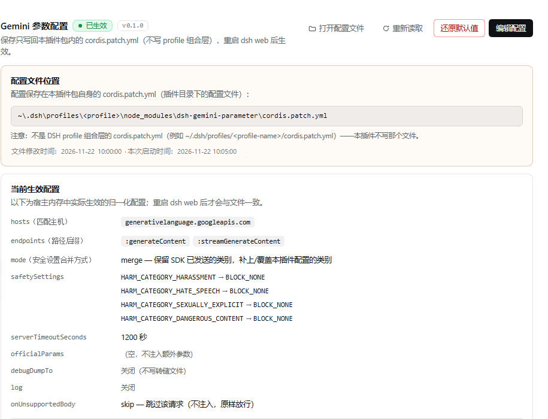
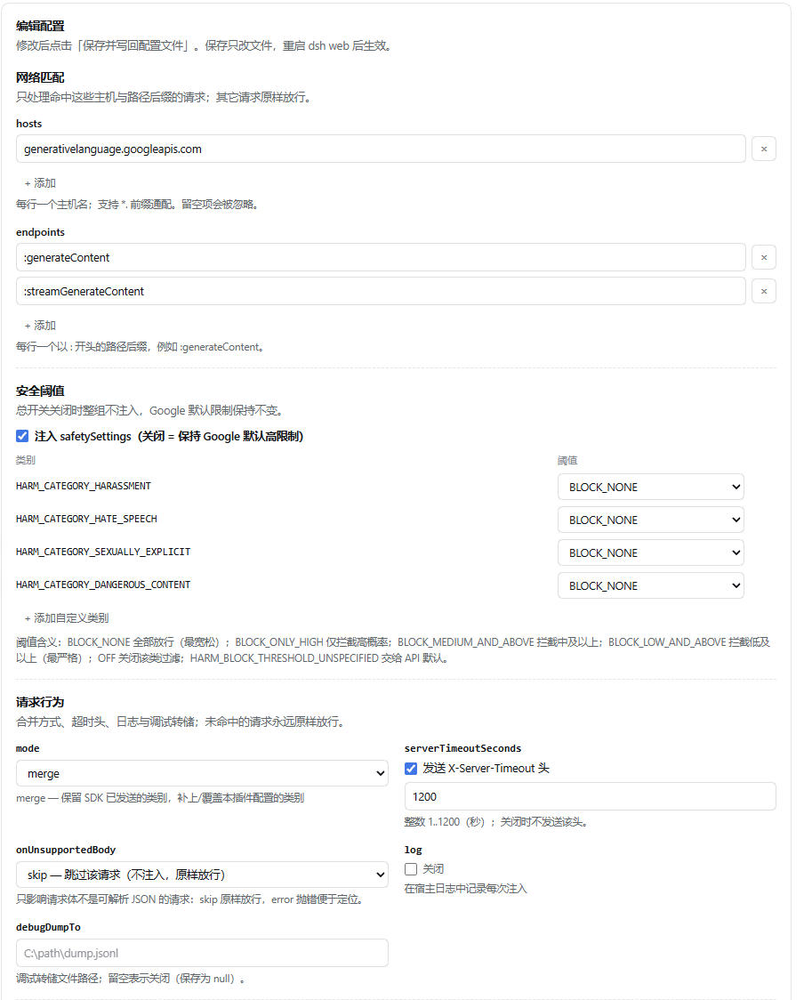

# dsh-gemini-parameter

[English](README.md) | [简体中文](README.zh-CN.md)

A host plugin for DSH (DeepSeek Harness) that adds the **official Gemini API parameter passthrough missing from DSH's native `google` route**. On demand, it attaches officially supported request fields to every Gemini request (streaming included): `safetySettings`, `X-Server-Timeout`, and a whitelist of `serviceTier` / `cachedContent` / `maxOutputTokens` (long-decode budget) / `mediaResolution` and more.

DSH's native Google adapter (pi-ai + `@google/genai`) only populates a small subset of the fields the official API accepts, and most official parameters have no setting entry. This plugin wraps `globalThis.fetch` inside the host process and applies a strict whitelist passthrough **only** to JSON requests against `:generateContent` / `:streamGenerateContent` on `generativelanguage.googleapis.com`. All other traffic passes through untouched, and nothing in the DSH / pi-ai / `@google/genai` installations is modified.

---

## 0. Purpose, scope & disclaimer (read this first)

> **This plugin is NOT a jailbreak.**

- **What it does**: uses `safetySettings`, a parameter explicitly supported by the official Google API (thresholds `BLOCK_NONE` / `BLOCK_ONLY_HIGH` / `BLOCK_MEDIUM_AND_ABOVE` / `BLOCK_LOW_AND_ABOVE` / `OFF`), to let the official model relax its filters on sensitive content. **This is an officially supported configuration item** — not a bypass, crack, or modification of the model itself.
- **What it is not**: "jailbreaking" usually means tricking the model with prompts, role-play, encoding tricks and the like. This plugin does none of that; it only sends official fields. Using this plugin as a substitute for jailbreak prompts **does not work**.
- **Jailbreak prompts get cut off cloud-side**: jailbreak-style prompts easily trip Google's cloud-side abuse/safety detection, and the request gets terminated outright (interrupted streams, abnormal `finishReason`, `429`/safety refusals). That is upstream behavior, unrelated to this plugin, and this plugin cannot make such requests pass reliably.
- **What it does not solve**: `stream ended without a finish reason` is a compatibility issue between Google's response format and DSH's parsing layer — a missing parameter is not the cause, and passthrough fields will not fix it. Use [TikaFlow/dsh-model-fix](https://github.com/TikaFlow/dsh-model-fix) for that (see [`docs/使用说明.md`](docs/使用说明.md) §4, in Chinese).
- **Lower safety ≠ anything goes**: `BLOCK_NONE` only **lowers the safety-filter threshold**; it absolutely does not mean Gemini can be used to generate any seriously illegal or harmful content. **CSAM (child sexual abuse material), terrorism and severe violence are intercepted by Google's enforced filters at any threshold**; attempting to generate such content leads to account bans and possible legal liability.
- **Disclaimer**: this plugin only passes official parameters through. **Anyone who uses this plugin to attempt any illegal activity bears all consequences themselves; the author is not responsible.**

---

## 1. Features

- Three independent groups of passthrough options: timeout header only, no lowered safety thresholds — or long-decode budget only — each group can be configured separately.
- Zero runtime dependencies, plain JS. The injection core is a single `lib/index.js`; the config panel adds a few small modules alongside it. Nothing in any official installation is modified.
- Idempotent: repeated installs / hot reloads never double-inject; on unload only its own `fetch` wrapper layer is restored.
- `officialParams` accepts whitelist keys only — a typo fails loudly at mount time instead of silently sending a wrong field to Google.
- Optional debug dump (records URL / status / what was injected — **never prompt content**).
- **Config panel on the plugin's detail page**: open **DSH settings → Plugins → `dsh-gemini-parameter`** and use the config section below the description to view / edit / save / reset defaults. Saves are written back to the package's own `cordis.patch.yml` (takes effect after restarting `dsh web`). If the config section fails to open or a save fails, the parameter-injection core keeps working.

## 2. Requirements

- DSH **>= 0.2.2-rc.1, < 0.3.0** (declared in `engines.dsh`; the plugin manager enforces this at install time).
- DSH's native Google route (a `GOOGLE_API_KEY` credential) — the plugin only ever touches `generativelanguage.googleapis.com` requests made by that route.
- The config panel needs the DSH web GUI. On a headless profile the injection still works; there is simply no panel to click.

## 3. Installation, config location, upgrades

```powershell
dsh plugin --profile web add github:FatBadger217/dsh-gemini-parameter
```

Restart `dsh web` after installing. The package lands in `~/.dsh/profiles/<profile>/node_modules/dsh-gemini-parameter` (Windows: `<user folder>\.dsh\profiles\<profile>\...`).

**Where the config lives**: in the package's own `cordis.patch.yml` (inside the install folder above) — *not* in the profile's patch. The recommended way to change it is the config panel, which validates on the host side, writes atomically, and keeps timestamped backups in `.config-backups\` next to it. Manual edits are possible too; either way, restart `dsh web` to apply. The panel shows a "restart needed" hint whenever the on-disk config differs from the running one.

**Upgrade note**: upgrading or reinstalling replaces the package directory (pnpm virtual store), so manual edits inside `cordis.patch.yml` and the `.config-backups\` history are lost in the process. Copy your config out before upgrading (the panel's file-reveal button opens the folder for you), then re-apply it afterwards.

```powershell
# upgrade
dsh plugin --profile web remove dsh-gemini-parameter
dsh plugin --profile web add github:FatBadger217/dsh-gemini-parameter
```

## 4. Configuration

Keys inside the `config` block of the package's `cordis.patch.yml`:

| Key | Default | Description |
|---|---|---|
| `hosts` | `["generativelanguage.googleapis.com"]` | Hostnames to match; exact domains, optional `*.` wildcard (matches the domain itself or any subdomain) |
| `endpoints` | `[":generateContent", ":streamGenerateContent"]` | URL path suffix match, each entry starts with `:`; `countTokens`, `files`, etc. are never touched |
| `relayUnwrap` | `[]` (off) | Relay compat prefixes: when a proxy such as billion-context rewrites model requests to `<loopback>/bili/<original-url>`, add `["/bili/"]` to match the embedded original URL and keep injecting (see below) |
| `safetySettings` | 4 categories at `BLOCK_NONE` | Array of `{category, threshold}` or an object map; `false` disables the whole group |
| `serverTimeoutSeconds` | `1200` | `X-Server-Timeout` value, integer 1..1200; `0`/`null`/`false` = don't send the header |
| `officialParams` | `{}` | Whitelisted official fields: top-level `generationConfig` / `serviceTier` / `cachedContent` / `labels` / `toolConfig`; 19 sub-keys inside `generationConfig` (`maxOutputTokens`, `thinkingConfig`, `mediaResolution`, `responseModalities`, …) |
| `mode` | `merge` | `safetySettings` merge semantics: `merge` / `replace` / `insert-only` |
| `debugDumpTo` | `null` | Debug: append URL, status and injection result per processed request as JSONL (no prompt content) |
| `log` | `false` | Print one host-log line per injection |
| `onUnsupportedBody` | `skip` | When the request body isn't parseable JSON: `skip` (pass through) or `error` (throw, for troubleshooting) |

The config panel exposes all of the above as a form (the 19 `generationConfig` sub-keys included); complex values are edited as JSON and validated before anything is written.

Three independent-group examples:

```yaml
# X-Server-Timeout only, no lowered safety thresholds
safetySettings: false
serverTimeoutSeconds: 1200

# Long-decode budget only, no lowered safety thresholds
safetySettings: false
officialParams:
  generationConfig:
    maxOutputTokens: 131072

# Cost first
safetySettings: false
officialParams:
  serviceTier: flex
```

The full field manual — data types, enums, injection/merge rules, common errors and upstream 400 signatures — is [`docs/使用说明.md`](docs/使用说明.md) §3 (in Chinese; English translation welcome via PR).

### Coexistence with URL-rewriting plugins (`relayUnwrap`)

Some in-host plugins (compression proxies, gateways, …) rewrite model requests to
`<loopback>/<prefix>/<original-url>` before handing them down the fetch chain. The
original hostname is then no longer in the host position, so plain `hosts` matching
silently stops injecting. `relayUnwrap` restores matching: for each configured path
prefix, the plugin unwraps the embedded original URL and matches against it.

General recipe for any such plugin:

1. **Spot it** — while the compat is off, the panel counts relay-rewritten requests
   and shows a warning card; the "matched" counters stay at 0 although the model
   itself works fine.
2. **Find the prefix** — check the rewriting plugin's docs or logs for the URL shape
   it produces, and take the path prefix it inserts (for billion-context: `/bili/`).
3. **Enable** — panel → *Edit config* → *Network matching* → add that prefix as a
   `relayUnwrap` row, then save and restart `dsh web` (hand-editing the YAML below is
   equivalent):

   ```yaml
   relayUnwrap:
     - /bili/
   ```

4. **Verify** — after the restart the warning card disappears and the request
   counters resume. The overview card lists the active prefixes and annotates known
   ones (`/bili/` → billion-context).

Worked example — [billion-context](https://github.com/ranxianglei/billion-context):
it rewrites requests to `<loopback>/bili/<original-url>`
(upstream discussion [billion-context#7527](https://github.com/ranxianglei/billion-context/issues/7527)),
so the prefix to add is `/bili/`. Note that this URL shape is currently an internal
convention of billion-context, not a documented contract — if a future release
changes it, the prefix may need updating.

### The config panel

Open **settings → Plugins → `dsh-gemini-parameter`**; the config section below the description shows what is currently in effect and edits it as a form.



*Read-only overview: an "applied" status badge and version, the configuration file location, the currently effective settings (hosts, endpoint suffixes, `relayUnwrap` prefixes with known-target annotations such as `/bili/` → billion-context, safety thresholds, timeout), and per-session request counters.*



*Edit form: host and endpoint-suffix matching, per-category safety thresholds, and request behavior options including merge mode, the X-Server-Timeout header, and the debug dump path. The full editor also covers the whitelisted `officialParams` fields; clicking **Save** validates on the host side, writes the package's `cordis.patch.yml` atomically (timestamped backup kept), and asks you to restart `dsh web` to apply.*

UI shown in Simplified Chinese — the panel follows the DSH locale and falls back to English for non-Chinese locales.

## 5. Verifying it works

```powershell
# unit tests (local mock fetch, no network)
npm test

# installed-profile config dump (PowerShell)
dsh --profile web --dump-config | Select-String -Pattern 'gemini-parameter' -Context 0,20
```

Additionally, set `log: true` or `debugDumpTo: <path>` to get one host-log line / one JSONL record per processed request. Seeing about two dump lines per agent step is normal — the main conversation request plus DSH's session-title generation request.

## 6. Uninstall / temporary disable

```powershell
dsh plugin --profile web remove dsh-gemini-parameter
```

To temporarily disable without touching files, override the bundle line in the profile patch (`- id: gemini-parameter` + `disabled: true`), or use `plugin_manager set_plugin`.

## 7. Versioning

Semantic Versioning. While the version is `0.x`, the public surface is still settling: **minor bumps may contain breaking changes** (config shape, panel behavior). From `1.0.0` on, strict semver applies. See [CHANGELOG.md](CHANGELOG.md).

## 8. Development

```powershell
git clone https://github.com/FatBadger217/dsh-gemini-parameter
cd dsh-gemini-parameter
npm test   # node --test, fully offline
```

No build step: `lib/client.js` is a hand-written module consumed directly by DSH's client `ModuleLoader` — keep it dependency-free (only `react` provided by the loader shell). Keep the zero-runtime-dependency rule for `lib/` when contributing.

## 9. License

[MIT](LICENSE) — Copyright (c) 2026 FatBadger217
