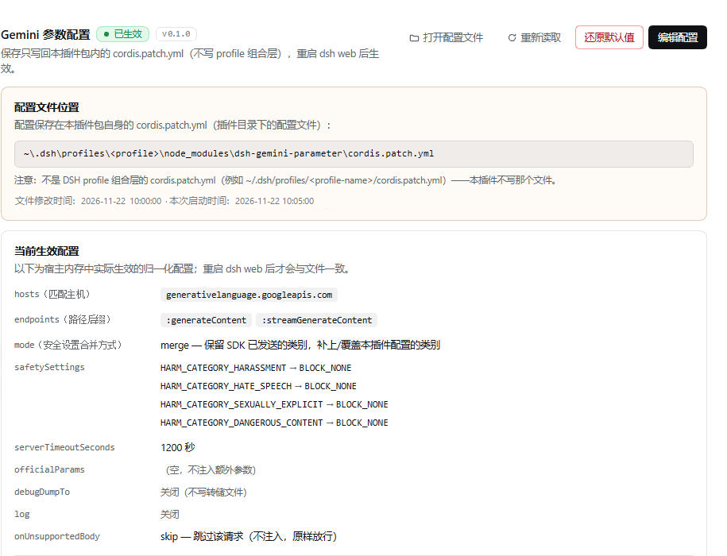
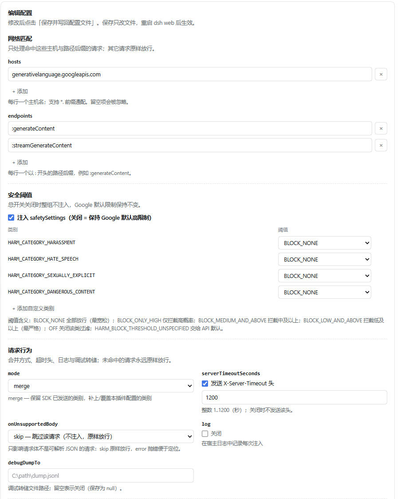

# dsh-gemini-parameter

[English](README.md) | 简体中文

给 DSH（DeepSeek Harness）用的宿主插件：**补上 DSH 原生 `google` 路由缺失的 Google 官方参数透传能力**。按需为每次 Gemini 请求（含流式）附加官方支持的请求字段：`safetySettings`、`X-Server-Timeout`，以及白名单内的 `serviceTier` / `cachedContent` / `maxOutputTokens`（长解码）/ `mediaResolution` 等。

DSH 的原生 Google 适配器（pi-ai + `@google/genai`）只构造 `model / contents / config` 里的少量字段，很多官方参数没有设置入口。本插件在宿主进程里包装 `globalThis.fetch`，只对 `generativelanguage.googleapis.com` 上 `:generateContent` / `:streamGenerateContent` 的 JSON 请求做白名单式透传，其余流量一律原样放行；不修改 DSH / pi-ai / `@google/genai` 安装包。

---

## 0. 用途、边界与免责声明（务必先读）

> **本插件不是破甲插件。**

- **它在做什么**：使用 Google 官方 API 明确支持的 `safetySettings` 参数（阈值可设 `BLOCK_NONE` / `BLOCK_ONLY_HIGH` / `BLOCK_MEDIUM_AND_ABOVE` / `BLOCK_LOW_AND_ABOVE` / `OFF`），让官方模型对敏感内容放宽限制。**这是受到 Google 官方支持的配置项**，不是绕过、破解或修改模型本身。
- **它不是破甲**：破甲通常指用提示词、角色扮演、编码绕过等手段欺骗模型；本插件不做这些，只发送官方字段。用本插件替代破甲提示词**不成立**。
- **破甲提示词会触发云端掐断**：jailbreak 类提示词很容易触发 Google 官方云端的滥用/安全检测，导致请求被直接终止（流中断、`finishReason` 异常、`429`/安全拒绝等）。这是上游行为，与本插件无关；本插件也无法让此类请求稳定通过。
- **它不解决的问题**：`stream ended without a finish reason` 属 Google 响应格式与 DSH 解析层的兼容问题，不是缺参数，透传字段解决不了；请用 [TikaFlow/dsh-model-fix](https://github.com/TikaFlow/dsh-model-fix)（详见 [`docs/使用说明.md` §4](docs/使用说明.md)）。
- **降低安全性 ≠ 什么都能生成**：`BLOCK_NONE` 只是**降低安全过滤阈值**，绝不意味着可以用 Gemini 生成任何严重违法犯罪内容。**CSAM（儿童性虐待内容）、暴恐、严重暴力等在任何阈值下都无法通过 Google 的强制拦截**；尝试生成这类内容会导致账号被封禁，并可能承担法律责任。
- **免责声明**：本插件只负责透传官方参数。**使用者若尝试使用本插件从事任何违法犯罪行为，一切后果由使用者自负，与作者无关。**

---

## 1. 特性

- 三组透传项**独立开关**：只想要超时头、不要低安全阈值，或只要长解码预算，都可以单独配置。
- 零运行时依赖、纯 JS；不修改任何官方安装包。
- 幂等：多次安装/热重载不会重复追加；卸载时只还原自己包装的那一层 `fetch`。
- `officialParams` 只接受白名单键，拼错会在挂载期直接报错，避免错误字段被静默发给 Google。
- 可选 debug dump（记录 URL/状态/注入了什么，**不记录 prompt**）。
- **配置面板（插件详情页配置区）**：在 **DSH 设置 → 插件 → 点开 `dsh-gemini-parameter`**，插件介绍下方的配置区里查看/编辑/保存/还原默认配置；保存写回**包内 `cordis.patch.yml`**（重启 `dsh web` 生效）；配置区打不开或保存失败**不影响参数注入主功能**。

## 2. 环境要求（Requirements）

- DSH `>=0.2.2-rc.1 <0.3.0-0`（见 `package.json` 的 `engines.dsh`）。
- DSH 原生 `google` 路由（`GOOGLE_API_KEY` 凭据）：本插件只处理该路由发往 `generativelanguage.googleapis.com` 的请求。

## 3. 安装

```powershell
dsh plugin --profile <名称> add github:FatBadger217/dsh-gemini-parameter
```

新增包需要**重启 `dsh web`** 后在 GUI 中生效。插件落盘在 `~/.dsh/profiles/<名称>/node_modules/dsh-gemini-parameter\`（Windows 为 `<用户目录>\.dsh\profiles\<名称>\node_modules\dsh-gemini-parameter\`）。

无论 GitHub 还是 npm 来源，安装与依赖解析均由 DSH 内置的 pnpm 自动完成，无需手动执行 npm/pnpm——本插件本身也是零运行时依赖。

## 4. 配置项（`cordis.patch.yml` 的 `config`）

改配置**首选插件详情页的配置面板**（见下节）；手工编辑包内 `cordis.patch.yml` 也可以，改完需重启 `dsh web`。**配置不在 profile 的 `cordis.patch.yml`**。

| 键 | 默认值 | 说明 |
|---|---|---|
| `hosts` | `["generativelanguage.googleapis.com"]` | 命中主机名；每项为精确域名，支持 `*.` 前缀通配（匹配去通配后的域名本身或任意子域名） |
| `endpoints` | `[":generateContent", ":streamGenerateContent"]` | URL path 后缀匹配，每项以 `:` 开头；`countTokens`、`files` 等默认不会被动 |
| `safetySettings` | 四类 `BLOCK_NONE` | 数组 `{category, threshold}` 或对象映射；`false` 表示**整组关闭**（只透传其它参数） |
| `serverTimeoutSeconds` | `1200` | `X-Server-Timeout` 值，1..1200 整数；`0`/`null`/`false` 均为不发送该头 |
| `officialParams` | `{}` | 官方字段白名单：顶层 `generationConfig` / `serviceTier` / `cachedContent` / `labels` / `toolConfig`；`generationConfig` 内 19 个子键（`maxOutputTokens`、`thinkingConfig`、`mediaResolution`、`responseModalities`…） |
| `mode` | `merge` | `safetySettings` 合并语义：`merge` / `replace` / `insert-only` |
| `debugDumpTo` | `null` | 调试：把每个被处理请求的 URL、状态、注入结果追加为 JSONL（不含 prompt） |
| `log` | `false` | 每次注入在宿主日志打一行 |
| `onUnsupportedBody` | `skip` | 请求体不是可解析 JSON 时：`skip` 放行，`error` 抛错（排查用） |

各字段的完整语义（数据类型、枚举、注入/合并规则、常见错误与上游 400 特征）见 [`docs/使用说明.md` §3 字段手册](docs/使用说明.md)。

三组独立示例：

```yaml
# 只要 X-Server-Timeout，不要低安全阈值
safetySettings: false
serverTimeoutSeconds: 1200

# 只要长解码，不要低安全阈值
safetySettings: false
officialParams:
  generationConfig:
    maxOutputTokens: 131072

# 成本优先
safetySettings: false
officialParams:
  serviceTier: flex
```

## 5. 配置面板

配置入口在 **DSH 设置 → 插件 → 点开 `dsh-gemini-parameter`**：插件介绍下方的配置区里可**查看配置概览、编辑、保存、还原默认、打开配置文件**。保存由**服务端权威校验**后写回**包内 `cordis.patch.yml`**（原子写入 + 时间戳备份，备份文件在包目录的 `.config-backups\` 内），需**重启 `dsh web`** 生效。配置区打不开或保存失败**不影响参数注入主功能**。





## 6. 验证

```powershell
# 1) 单元测试（本地 mock fetch，不联网；在仓库根执行）
npm test        # 37 项用例应全部通过

# 2) 注入证据：临时开启 debugDumpTo（或 log: true），重启后发一次原生 google 请求，
#    JSONL 文件里应出现 injected=true 与实际注入内容（不记录 prompt）——详见 docs/使用说明.md §2

# 3) 已安装 profile 的配置
dsh --profile <名称> --dump-config | Select-String -Pattern 'gemini-parameter' -Context 0,20
```

注意：一个 step 产生 2 条左右 dump 属正常——主对话请求 + DSH 的会话标题生成请求（`session-title-llm`）。

## 7. 升级须知

- 升级或重装（重新执行 `add`，或 `remove` 后重新 `add`）会**整体替换插件包目录**（DSH 内置 pnpm 的虚拟 store 机制）：包内 `cordis.patch.yml` 的**手工修改内容**会被新版本默认配置覆盖，配置面板自动生成的 `.config-backups\` 备份也会一并丢失。
- **升级前先导出/复制配置**：可用配置面板的“打开配置文件”定位包内 `cordis.patch.yml`，复制或另存一份；升级后把 `config:` 段改回（或用配置面板重新编辑保存），再重启 `dsh web`。详见 [`docs/使用说明.md` §7 升级与重装须知](docs/使用说明.md)。

## 8. 卸载 / 临时停用

```powershell
dsh plugin --profile <名称> remove dsh-gemini-parameter
```

临时停用不改文件：在 profile 层覆盖该行（`- id: gemini-parameter` + `disabled: true`，见 [`docs/使用说明.md` §6](docs/使用说明.md)），或 `plugin_manager set_plugin`。

## 9. 目录

```
仓库根/
  package.json                    清单（dsh.bundle.patch 指向下面的 patch；dsh.client 声明客户端半区）
  cordis.patch.yml                bundle 补丁（含默认 config —— 配置在这里改）
  lib/index.js                    宿主实现：fetch 包装 + 参数注入 + 面板宿主侧 RPC
  lib/config-file.js 等           面板配套（config-file / reveal / panel-core / panel-service / client）
  locale/en.json, zh.json         插件管理器显示名/描述
  icon.svg                        插件图标
  LICENSE                         MIT 许可证
  screenshots.json                商店截图清单（指向 docs/screenshots/）
  CHANGELOG.md                    变更记录
  README.md / README.zh-CN.md     英文 / 中文 README
  docs/使用说明.md                 字段手册 + 常见问题
  docs/维护文档.md                 架构、上游依赖、排障、变更记录
  test/*.test.mjs                 单元测试（mock-fetch / config-file / panel-core / client-smoke，共 37 项）
```

## 10. 版本策略（Versioning）

本插件遵循 [Semantic Versioning](https://semver.org/)：**0.x 阶段次版本号（`0.x`）升级即可能包含破坏性变更**，升级前请先读变更记录；从 `1.0` 起遵循严格 semver（破坏性变更只随主版本号发布）。变更明细见 [CHANGELOG.md](CHANGELOG.md)。

## License

MIT © FatBadger217。变更历史见 [CHANGELOG.md](CHANGELOG.md)。
